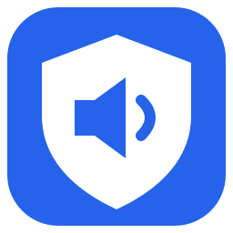

<div align="center">
  
  <h1>VolumeGuard</h1>
  <p>Un límite de volumen para Windows, administrado por ti.</p>
  <p>
    <a href="https://github.com/deimisq/VolumeGuard/releases/download/v1.0.3/VolumeGuard-Setup-1.0.3.exe"></a>
  </p>
  <p>Versión de prueba 1.0.3 · Sin firma digital · <a href="https://github.com/deimisq/VolumeGuard/releases/tag/v1.0.3">Notas y comprobación SHA256</a></p>
  <p>
    <a href="LICENSE"></a>
    <a href="installer/VolumeGuard.iss"></a>
    <a href="https://github.com/deimisq/VolumeGuard/actions/workflows/build.yml"></a>
    <a href="https://github.com/sponsors/deimisq"></a>
  </p>
  <p>
    
    
    
  </p>
  <p>
    <strong>Español</strong> · <a href="README.en.md">English</a> ·
    <a href="#instalación">Instalación</a> ·
    <a href="https://github.com/sponsors/deimisq">Apoyar al creador</a> ·
    <a href="CONTRIBUTING.md#español">Colaborar con código</a> ·
    <a href="https://github.com/deimisq/VolumeGuard/issues">Reportar un problema</a>
  </p>
</div>

---

VolumeGuard mantiene el volumen maestro de los dispositivos de salida activos por debajo de un porcentaje elegido por el administrador. Su servicio arranca con Windows y continúa funcionando aunque cierres el panel.

## Qué puedes hacer

| Función | Cómo funciona |
|---|---|
| Elegir un límite | Usa la barra o pulsa el porcentaje para escribir un valor de 0 a 100. Guarda para aplicarlo. |
| Mantener el control activo | El servicio se inicia automáticamente como LocalSystem. Cerrar el panel no lo detiene. |
| Proteger la configuración | El panel solicita UAC y el instalador restringe los ajustes a administradores y SYSTEM. |
| Ocultar el panel | Minimizar o pulsar la X lo deja junto al reloj. Doble clic en el icono lo abre de nuevo. |
| Usar tu idioma | Instalador y panel en español e inglés; el instalador preselecciona el idioma de Windows. |
| Consultar el estado | Muestra el límite aplicado y las incidencias del servicio. |

## Instalación

**[Descargar VolumeGuard-Setup-1.0.3.exe](https://github.com/deimisq/VolumeGuard/releases/download/v1.0.3/VolumeGuard-Setup-1.0.3.exe)** — instalador para Windows 11 x64, con .NET incluido.

La descarga pública está en [Releases → Assets](https://github.com/deimisq/VolumeGuard/releases/tag/v1.0.3), junto con `SHA256SUMS.txt`. No necesitas una cuenta de GitHub para descargarla. Es una **versión de prueba**: requiere validar instalación y audio con los dispositivos de destino. El hash permite comprobar la integridad; no sustituye una firma digital.

También puedes compilar desde el código o consultar los artefactos de desarrollo en [GitHub Actions](https://github.com/deimisq/VolumeGuard/actions/workflows/build.yml).

> **Firma pendiente:** los instaladores de desarrollo no están firmados. La solicitud de firma gratuita aún no ha sido aprobada. Consulta la [política de firma](docs/CODE_SIGNING.md).

1. Ejecuta el instalador como administrador y elige Español o English.
2. Abre **VolumeGuard**, selecciona un porcentaje y pulsa **Guardar límite**.
3. Comprueba el estado **Protección activa** y el límite aplicado.

La instalación crea un servicio de Windows y protege su carpeta de configuración. La desinstalación detiene y elimina el servicio. Para actualizar, cierra primero el panel desde el menú de su icono. Para cambiar el idioma, vuelve a ejecutar el instalador y elige el otro idioma.

## Apoyar al creador

[](https://github.com/sponsors/deimisq)

VolumeGuard es gratuito y de código abierto. Tu aporte voluntario ayuda a mantener este y otros proyectos de **deimisq**. **Todas las funciones están disponibles sin donar**; un aporte no compra soporte prioritario ni compromisos de entrega.

Los pagos se realizan en GitHub, fuera de la app. [Más información sobre los aportes](docs/SUPPORT.md).

## Colaborar con código o reportar errores

| Quiero… | Dónde hacerlo |
|---|---|
| Aportar dinero al creador | [GitHub Sponsors](https://github.com/sponsors/deimisq) |
| Corregir código o documentación | [Guía para colaborar](CONTRIBUTING.md#español) |
| Reportar un problema o sugerir una mejora | [Issues de VolumeGuard](https://github.com/deimisq/VolumeGuard/issues) |
| Comunicar una vulnerabilidad | [Política de seguridad](SECURITY.md) |

Se aceptan incidencias y contribuciones en español e inglés. Elimina datos personales de los registros antes de compartirlos.

## Compilar desde el código fuente

**Requisitos:** Windows 11 x64, .NET SDK 8 o posterior e Inno Setup 6. La primera restauración de dependencias necesita acceso a NuGet.

```powershell
powershell -NoProfile -ExecutionPolicy Bypass -File .\build.ps1
```

Si Inno Setup está instalado en otra ubicación:

```powershell
powershell -NoProfile -ExecutionPolicy Bypass -File .\build.ps1 -InnoSetupCompiler 'C:\Tools\Inno Setup 6\ISCC.exe'
```

Resultado: `dist/VolumeGuard-Setup-1.0.3.exe`. También hay una tarea de compilación en VS Code y un [workflow de GitHub Actions](.github/workflows/build.yml).

## Límites y compatibilidad

- Se comprueba el volumen aproximadamente cada **120 ms**: pueden existir picos breves por encima del límite.
- El porcentaje de Windows **no equivale a decibelios ni garantiza una exposición acústica segura**.
- No controla amplificadores externos ni controles físicos independientes.
- No es una barrera contra administradores, SYSTEM o acceso al equipo desde otros medios de arranque.
- Algunos controladores de audio pueden no funcionar desde un servicio en sesión 0. Valida los dispositivos de destino; esos casos necesitarían un agente por sesión de usuario.
- Se han compilado los ejecutables y el instalador y comprobado la interfaz. Las nuevas versiones deben validarse mediante instalación y pruebas reales de audio antes de distribuirse.

<details>
<summary><strong>Configuración y diagnóstico</strong></summary>

- Límite inicial: **40 %**.
- Ajustes: `%ProgramData%\VolumeGuard\settings.json`; se releen sin reiniciar el servicio.
- Si falla la lectura, se conserva el último límite válido. Hasta leer el primero se aplica **0 %**.
- Estado: `status.json`, actualizado aproximadamente cada 2 segundos. El panel avisa tras más de 10 segundos sin actualización.
- Registro local: `service.log`, con rotación a `service.log.old` al superar aproximadamente 1 MB; máximo una entrada por minuto.
- Errores del instalador: `setup-error.log` en la carpeta de instalación.
- Sin cuentas en línea, publicidad ni telemetría propia. Los registros técnicos pueden contener rutas con nombres de usuario.

</details>

<details>
<summary><strong>Preparación experimental para Store</strong></summary>

La distribución principal es el instalador EXE con servicio administrativo. Se conserva una edición Store experimental por usuario, sin servicio ni elevación, que solo controla el volumen mientras está abierta. **No se distribuye actualmente por Microsoft Store.**

Consulta las [guías de preparación](docs/store/README.es.md) si necesitas estudiar esa variante. Sus APPX/MSIX de desarrollo usan una identidad ficticia y no deben enviarse a la tienda.

</details>

## Licencia y autoría

[](LICENSE)

Creado y mantenido por [deimisq](https://github.com/deimisq). Código disponible bajo [licencia MIT](LICENSE). Consulta también la [política de firma](docs/CODE_SIGNING.md) y la [guía de seguridad](SECURITY.md).
